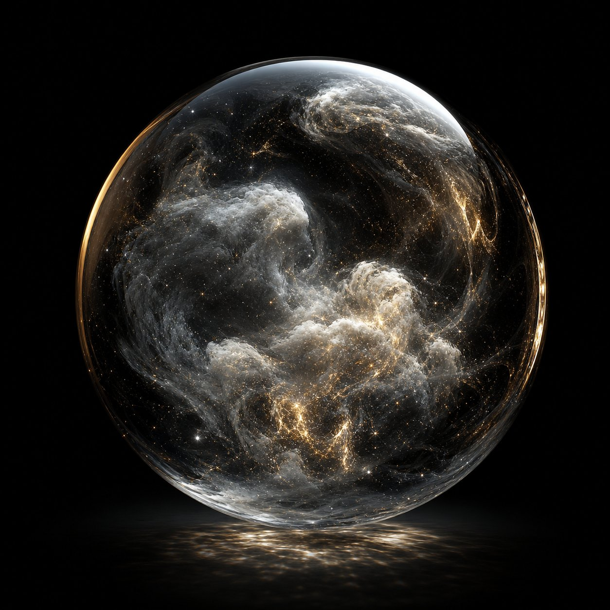

# Project Genie — Scene Studio

**Cinematic 3D world building, right in the browser.** A glassy, iPad-first scene development studio in the spirit of Google's Project Genie — PBR rendering, an asset vault with smart texture wiring, cinematic photo mode, and one-click export. No build step. Pure static files. Host it anywhere.



## ✨ What's inside

### 🎬 Real-time cinematic rendering
- Three.js r180 · WebGL2 · physically based materials (metalness / roughness / clearcoat / emissive / AO)
- ACES filmic tone mapping · HDR pipeline (HalfFloat + 4× MSAA) · UnrealBloom · custom filmic grade pass (saturation, contrast, temperature, fade, vignette, animated film grain)
- Procedural Preetham sky with full sun control (elevation / azimuth / turbidity / Rayleigh), IBL studio reflections, PCF soft shadows (1024→4096 by quality tier)
- Six cinematic world presets: **Golden Hour · Daylight · Noir · Midnight · Overcast · Dawn**
- Live fog, hemisphere ambience, camera FOV, field-of-view grade controls

### 📦 Asset Vault — drop *anything* in
- `GLB · GLTF · OBJ (+MTL) · FBX · STL · PLY` · textures `PNG JPG WebP AVIF GIF BMP` · `HDR` environments
- **ZIP archives of any size** (multi-MB game-ready kits welcome) — nested paths resolved automatically, including models in subfolders with external `.bin` / MTL textures
- Drag cards straight into the viewport — assets land *flush* on whatever is beneath them (surface placement / "objects kissing")
- Drag textures onto the model *or* onto any individual material slot in the inspector
- **✦ Smart Match** — toggle in Settings. On import, loose textures are matched to their model's materials by filename DNA (`albedo / diffuse / basecolor · normal · roughness · metallic · AO · emissive`) with a Strict / Balanced / Loose sensitivity, and wired into the right slots automatically. Match report shown in the vault log
- Offscreen-rendered thumbnails for every imported model

### 🛠 A real studio toolset
- Select / Move / Rotate / Scale gizmos (world & touch friendly, 0.82× gizmo on touch)
- Grid snap (0.1–2 m), 15° rotation snap, surface snap, snap-to-ground, center-on-origin, normalize-size, duplicate, delete
- Layers panel (outliner): select · visibility · lock — for every object
- Inspector: transform TRS · full material editing · 6 texture slots (tap-to-assign / drag-drop / clear) · tiling & offset · normal strength · shadow flags
- Procedural world-gen: **Terrain** (seeded FBM heightmap, vertex-colored), **Rock**, **Pine**, **Water** (clearcoat reflective plane), plus a torus-knot sculpture primitive
- Deterministic generation → scenes survive save/reload perfectly

### 📸 Photo mode — shoot the world
- Letterbox bars for 1:1 · 4:5 · 3:2 · 16:9 · **2.39:1 cinematic** · rule-of-thirds grid
- Filters: None · Noir · Golden · Teal/Orange · Fade · Vivid
- Timer (3/5/10 s) · 1×/2×/4× capture up to 3840 px · shot strip with tap-to-download · flash feedback

### 💾 Projects, exports & safety
- **Export scene as GLB** · **selection as GLB** · **selection as STL** (3D-print ready)
- **Save Project** (`.genieproj.json` — full fidelity, assets embedded) → re-open instantly
- **Browser backup** (localStorage, autosave every 45 s, size-guarded) — reload and your world is right there
- 50-step undo/redo (transform, create, delete, duplicate, material, texture, lock)
- Keyboard shortcuts (Q/W/E/R/F/G/H/P/Space/⌘S/⌘Z/⌘D/Del/Esc)

### 📱 iPad · touch · Pencil-ready
- One-finger orbit · two-finger pan/zoom · tap to select · large touch targets (44 px) on coarse pointers
- Portrait/small screens collapse panels into floating sheets (rail still available)
- `touchHint` bar and adaptive grid; safe-area insets respected in photo mode

## 🚀 Run it

It's a static site — `index.html` at the repo root.

**GitHub Pages (zero config):** Settings → Pages → *Deploy from a branch* → pick this branch → folder `/ (root)` → Save. Done — `https://<you>.github.io/voxel-boxes-and-worlds/`

**Local:**
```bash
npx http-server -p 8080 .
# open http://localhost:8080
```

No build, no npm install — Three.js r180 and JSZip are vendored in `vendor/`.

## ⌨️ Shortcuts

| Key | Action | Key | Action |
|---|---|---|---|
| `Q` `W` `E` `R` | Select · Move · Rotate · Scale | `⌘/Ctrl+D` | Duplicate |
| `F` | Focus selected | `Del / ⌫` | Delete |
| `G` | Toggle grid snap | `H` | Hide all UI chrome |
| `⇧G` | Toggle grid | `P` | Photo mode |
| `Esc` | Deselect / close | `Space` | Shutter (in photo mode) |
| `⌘/Ctrl+S` | Browser backup | `⌘/Ctrl+Z` `⇧⌘/Ctrl+Z` | Undo · Redo |

## 🗂 Architecture

```
index.html        — app shell (top bar, rail, panels, inspector, photo mode, splash)
css/style.css     — Genie-glass design system (blur, saturate, pill buttons, orb hero)
js/engine.js      — renderer · composer · sky · lights · selection · gizmos · serialization snapshots
js/assets.js      — AssetStore · ZIP extraction · GLTF/OBJ/FBX/STL/PLY/HDR parsing · ✦ Smart Match
js/ui.js          — panels · inspector · outliner · asset vault · photo mode · toasts · modals
js/main.js        — App orchestration · undo/redo · project save/open · exports · starter diorama
vendor/           — three r180 + addons (loaders, exporters, post FX, Sky, RoomEnvironment) · JSZip
```

**Serialization** is deterministic: primitives/procedurals re-generate from seed params; uploaded models re-instantiate from cached parsed templates (material overrides referenced by mesh path). Full project files embed raw asset bytes as base64.

## 🧭 Notes & limits
- Uploaded assets live in memory — export a **Save Project** to keep them (browser backups may omit multi-MB models).
- `.exr` decode isn't bundled; convert to `.hdr` for custom environments.
- WebGL2 required (every iPad since 2017, all modern browsers).

Made with Three.js · glassmorphism-inspired UI · a tiny bit of magic ✦
